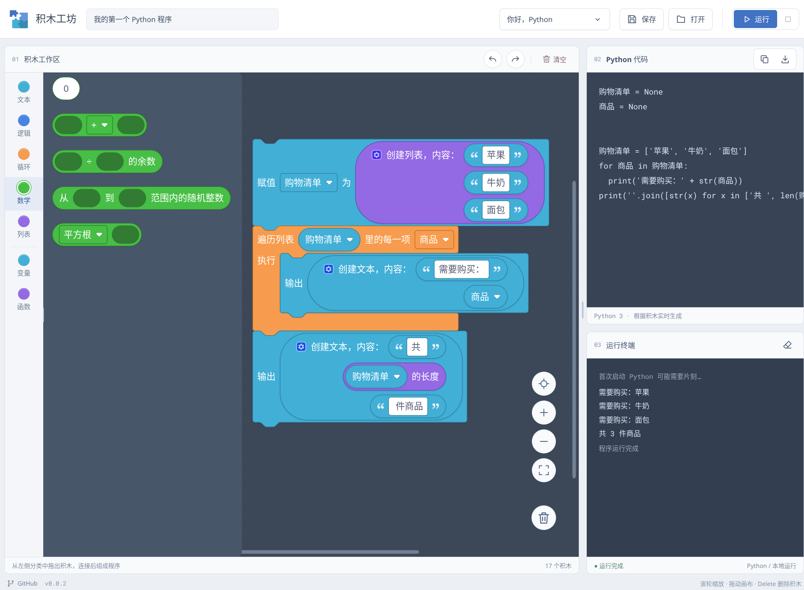

# 积木工坊 · Python Studio

当前版本：`v0.0.3`

中文 Blockly 图形化 Python 编程应用。拖拽积木实时生成 Python，在浏览器的独立 Web Worker 中通过 Pyodide（CPython / WebAssembly）执行。



## 本地启动

需要 Node.js 20.19+（或 22.12+）。

```bash
npm install
npm run dev
```

打开终端显示的本地地址（默认 http://127.0.0.1:5173）。

```bash
npm run build
npm run preview
```

## 功能

- 中文积木：文本、逻辑、循环、数学、列表、变量、函数。
- 实时 Python 代码、复制与 `.py` 下载。
- 保留中文变量名、函数名和参数名，自动避让 Python 关键字、内置名称和规范化后的重名。
- 独立线程运行，标准输出、错误显示、交互输入、手动停止、60 秒超时。
- 9 个积木示例：你好 Python、累加求和、奇偶判断、交互问候、发射倒计时、九九乘法表、购物清单、阶乘与平方函数。
- 浏览器自动保存、JSON 作品导入导出、撤销重做。
- 桌面双栏和窄屏上下布局。
- 拖动工具箱边缘或右侧面板分隔条调整宽度，自动记住布局；双击分隔条恢复默认，也支持聚焦后使用左右方向键调整。

依赖安装后，Python 运行资源从本地提供，无须连接 CDN。首次启动需要加载较大的 WASM 文件。每次运行使用全新的 Python 环境；输出最多显示 1000 行。

## 部署说明

`dist/` 为静态构建产物。部署须使用 HTTPS（本地 localhost 亦可），并返回以下响应头以支持交互输入使用的 SharedArrayBuffer：

```text
Cross-Origin-Opener-Policy: same-origin
Cross-Origin-Embedder-Policy: require-corp
```

Vite 开发与预览服务器已配置。浏览器内的 Python 没有本机文件访问权限，文件系统为临时虚拟文件系统。运行环境支持 Python 标准库；本应用未提供额外第三方 Python 包安装界面。

## CI 与版本发布

GitHub Actions 在推送到 `main` 或提交 PR 时执行 `npm ci`、测试和生产构建。手动运行工作流也只做检查，不会创建 Release。

更新 `package.json` 和锁文件中的版本号即可更新页面显示，**不需要打 tag，也不会自动发布**。例如：

```bash
npm version patch --no-git-tag-version
# 同步更新本 README 中的版本号，然后提交代码
```

准备发布时，先确保代码已推送、版本号与 tag 一致，再推送版本 tag（以下以 `0.0.3` 为例）：

```bash
git tag -a v0.0.3 -m "v0.0.3"
git push origin v0.0.3
```

工作流会重新测试、构建，成功后创建 GitHub Release，并附上：

- `blockly-py-v0.0.3.zip`：可部署的静态网页，包含完整 Python 运行资源；解压后根目录即 `index.html`。
- `SHA256SUMS`：构建包的 SHA-256 校验值。

tag 与 `package.json` 版本不一致时发布失败；`v0.0.3-rc.1` 这类带后缀的版本会标记为预发布。重跑成功的 tag 工作流会更新对应 Release 的附件，不重复创建 Release。

构建包包含适用于 Cloudflare Pages、Netlify 等平台的 `_headers` 文件；其他静态服务器仍需按上面的部署说明配置两个跨源隔离响应头。工作流不会自动部署网站，也不会为已存在的旧 tag 补发 Release。

### 容器镜像

版本 tag 触发的工作流在测试与构建通过后，还会构建 Nginx 静态站点镜像并推送到 GitHub Container Registry：

```text
ghcr.io/<owner>/<repo>:0.0.3   # 与 tag 对应的版本
ghcr.io/<owner>/<repo>:latest  # 仅稳定版本更新
```

- 预发布 tag（如 `v0.0.3-rc.1`）只推送带后缀的版本标签，不会覆盖 `latest`。
- 镜像已内置 `Cross-Origin-Opener-Policy`、`Cross-Origin-Embedder-Policy` 响应头，并提供 `/healthz` 健康检查。
- 仓库为私有或组织仓库时，首次推送后需在包设置中确认可见性；拉取私有镜像前需要 `docker login ghcr.io`。

运行：

```bash
docker run --rm -p 8080:80 ghcr.io/<owner>/<repo>:latest
```

打开 http://localhost:8080 即可使用。
